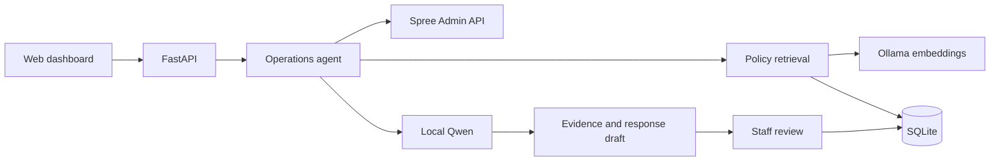

# COA | Commerce Operations Agent

COA brings Spree order records and store policies into one workspace. Support staff
can investigate an order, inspect the supporting evidence, and prepare a customer
response for review without switching between the commerce platform and policy documents.

## Features

- Order investigations through typed, read-only Spree tools.
- Policy retrieval using local embeddings, versioned documents and page citations.
- Browser conversations with Qwen, including follow-up questions about a selected report.
- Structured findings, response drafts, source evidence and tool-call traces.
- Internal approval and rejection with review notes and version checks.
- Persistent reports in SQLite, with JSON downloads.
- Light and dark themes, responsive layouts and saved appearance preferences.

## Architecture



Live order facts come from Spree. Store guidance comes from indexed policy documents.
The application validates tool arguments and evidence identifiers before returning a
report. Staff review drafts before using them in customer communication.

| Component | Technology |
| --- | --- |
| Application API | Python 3.13, FastAPI, Pydantic |
| Model inference | Ollama, Qwen 3 |
| Policy embeddings | nomic-embed-text |
| Commerce integration | HTTPX, Spree 6 Admin API v3 |
| Persistence | SQLite |
| Dashboard | HTML, CSS, JavaScript |
| Automated checks | pytest, GitHub Actions |

[Architecture and API reference](docs/architecture.md)

## Installation

Install Python 3.13, Git and Ollama. Keep Ollama running in the background.
For live order access, run a Spree 6 store separately.

```powershell
git clone https://github.com/Emmanuel-Rono/COA.git
cd COA
py -3.13 -m venv .venv
.\.venv\Scripts\python.exe -m pip install -r requirements.lock.txt
.\.venv\Scripts\python.exe configure.py
ollama pull qwen3:1.7b
ollama pull nomic-embed-text
```

`configure.py` creates a private `.env` file and a server signing key. Existing
configuration is preserved. The dashboard opens a local browser session automatically;
users do not enter service keys in the interface.

## Configuration

The default `SPREE_MODE=fixture` uses the sample order records in `examples/store.json`.
Model inference and policy embeddings still run through Ollama.

For live Spree access, edit `.env`:

```dotenv
SPREE_MODE=live
SPREE_BASE_URL=http://localhost:3000
SPREE_API_KEY=sk_your_read_only_key
STORE_ID=your_store_id
DEFAULT_ORDER_REFERENCE=your_order_number
```

Use a secret key scoped to `read_orders`, `read_fulfillments` and `read_products`.
The key selects the store; `STORE_ID` identifies that same store. Keep keys and local
order references in `.env`. All available settings are listed in `.env.example`.

## Run

```powershell
.\.venv\Scripts\python.exe -m uvicorn app.main:create_app --factory --host 127.0.0.1 --port 8001 --workers 1
```

Open [localhost:8001](http://localhost:8001).

1. Open **Knowledge** and upload a policy or select **Load demo policy**.
2. Return to **Assistant**, enter an order reference and select **Investigate order**.
3. Inspect the response draft, recorded facts, citations and tool trace.
4. Ask follow-up questions in the conversation panel.
5. Add a review note and approve or reject the internal report.

Use `DEMO1007` in fixture mode or an order number from your connected store in live mode.
**Reports** opens saved investigations. **Settings** controls appearance and connection checks.
The model loads when a request is submitted. Run one investigation at a time on CPU.

## Testing

Run the automated suite without starting Spree or loading a model:

```powershell
.\.venv\Scripts\python.exe -m pytest -q --junitxml=reports/tests.xml
```

The suite covers session access, request origins, store boundaries, read-only API
requests, tool restrictions, citation validation, policy lifecycle, report persistence,
review decisions and browser-chat API contracts.

Run the integration check against your configured Ollama models and order source:

```powershell
.\.venv\Scripts\python.exe verify_integration.py --order-reference YOUR_ORDER_NUMBER
```

In fixture mode, omit `--order-reference` to use `DEMO1007`. The check indexes a policy,
investigates the order, validates returned evidence, approves an internal report and
checks the saved review. It uses a temporary application database and writes the result
to `reports/integration.json`. Spree records remain unchanged.

GitHub Actions runs the isolated pytest suite on pushes and pull requests and uploads
JUnit results. Integration checks use the separately configured local services.

## Repository structure

```text
app/                    API, agent, retrieval, model client and persistence
static/                 Dashboard, themes and browser interactions
examples/               Sample policies and test order fixtures
tests/                  Automated application and access-control tests
docs/architecture.md    Design decisions and API reference
configure.py            Private environment setup
verify_integration.py   Explicit integration check using local services
requirements.lock.txt   Pinned application and test dependencies
```

## Operating scope

COA serves one configured store and one local staff workspace. Browser sessions are
restricted to loopback access and use signed HttpOnly cookies with origin checks.
Programmatic API calls use the server token. Spree credentials stay on the server.

Policy ingestion supports text PDFs, TXT and Markdown. Investigations use a maximum
of five allowed tool calls. Processing is synchronous and runs in one server worker.
Interrupted investigations are marked failed after restart.

Approvals save internal artifacts. Customer messaging, refunds and commerce record
updates are outside the application's actions. Source identifiers are validated;
staff remain responsible for reviewing the meaning and accuracy of generated text.

Local configuration, databases, uploads, model files and reports are excluded from
version control. Back up `.env` and `data/` privately before replacing an installation.
