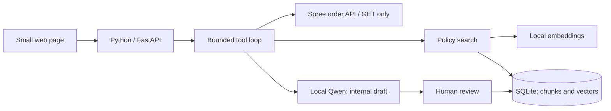

# COA — Commerce Operations Agent

COA helps staff inspect a Spree order, find a relevant policy, and prepare a response.
Qwen chooses from two read-only tools. The app shows current order facts, policy
citations and the tool trace. A person reviews the draft. Approval saves it locally;
it does not send a message or change Spree.

## Simple design



One app, one database, two external dependencies: Spree and Ollama.
Policies use embeddings because users may describe the same rule in different words.
Order facts use the API because status can change. SQLite vector search is a simple
Python cosine calculation over a small policy library; Qdrant is a later scaling choice.

## Install and run

Python 3.13 and Ollama are required. Start Ollama and prepare these models:

```powershell
ollama pull qwen3:1.7b
ollama pull nomic-embed-text
py -3.13 -m venv .venv
.\.venv\Scripts\python.exe -m pip install -r requirements.lock.txt
.\.venv\Scripts\python.exe configure.py
.\.venv\Scripts\python.exe -m uvicorn app.main:create_app --factory --host 127.0.0.1 --port 8001 --workers 1
```

Open **http://localhost:8001**. Copy `APP_API_TOKEN` from your private `.env` into
the access form. Click **Load demo delivery policy**, then investigate `DEMO1007`.
CPU processing can take several minutes. Run one task at a time. No hosted model account or cloud key is required.

Default `SPREE_MODE=fixture` uses the clearly labelled records in `examples/store.json`.
Qwen inference and embeddings are real in both modes. Fixture mode never silently
replaces a failed live API request.

## Connect your Spree store

This adapter targets **Spree 6.0.6, Admin API v3**. Start Spree separately.
Create a server-side secret key with `read_orders,read_fulfillments,read_products` permissions.
Set these private settings:

```dotenv
SPREE_MODE=live
SPREE_BASE_URL=http://localhost:3000
SPREE_API_KEY=sk_your_read_only_key
STORE_ID=your_actual_store_id
```

Use a real order number or `or_` ID in the form. The key selects its store;
`STORE_ID` must agree with it. The adapter returns only whitelisted fields and
omits customer email, address and internal notes before model processing.

An optional `seed_demo.py` adds 50 demo products and one unpaid draft order to a
local development store. It requires explicit confirmation and creates a temporary
setup key, then revokes it. Run only with permission on a disposable local store:

```powershell
.\.venv\Scripts\python.exe seed_demo.py --spree-dir D:\Codes\QA\Spree-store --confirm-local-demo
```

The runtime app has no write key or write API methods. A draft order is not a paid
or shipped order. Live demo references can be recorded in `examples/live-order.json`.

## Tests and actual model check

```powershell
.\.venv\Scripts\python.exe -m pytest -q --junitxml=reports/tests.xml
.\.venv\Scripts\python.exe verify_demo.py
```

Pytest uses isolated fixtures and model doubles to test defined behaviours without
requiring servers. `verify_demo.py` separately exercises actual local inference,
embeddings, configured order access, citation validation and internal approval.
It saves the measured run in `reports/real-model-smoke.json`. Reports are private.
See [verification](docs/verification.md) for measured results and limits.

## Files you should understand

| File | Responsibility |
| --- | --- |
| `app/main.py` | Request validation and investigation endpoints |
| `app/agent.py` | Two allowed tools, five-call limit and cited draft validation |
| `app/spree.py` | Read-only live adapter and explicit fixture mode |
| `app/knowledge.py` | Policy ingestion, versioning, embeddings and retrieval |
| `app/model.py` | Ollama HTTP requests and one schema-repair attempt |
| `app/storage.py` | Durable runs, audit events and versioned review decisions |
| `static/` | Plain HTML, CSS and JavaScript interface |

The request path is: validate staff token → resolve configured store → let Qwen
choose an allowed tool → retrieve data → generate and validate a draft → human review.
The code owns permissions and calculations; the model does not.

## Boundaries and next steps

- This is a single-store demo with one staff token, not multi-user production auth.
- PDF text, TXT and Markdown policies are supported. Scans need future OCR.
- Retrieved source IDs are validated. This does not prove every generated sentence
  is correct; inspect the sources and draft before approval.
- Conflicting policies and malicious document content need broader evaluation.
- Requests run synchronously. Interrupted runs become failed on restart. Use one
  worker. A queue and multi-process deployment are later work.
- Search uses up to five chunks, roughly 300 words with 60-word overlap per page.
  The similarity cutoff is an initial setting, not a measured accuracy claim.
- Changing the embedding model requires re-uploading policies. Same-title uploads
  replace the active version; deletion removes its chunks from retrieval. Existing
  reports retain the source snapshot used when they were created.

## Docker and GitHub

`docker compose up --build` runs this app on port 8001 with its own data volume.
The compose file assumes Docker Desktop: Ollama and Spree run on the host.
Images use a Python minor-version tag, not a verified immutable/offline release.
Keep `.env`, `data/`, tokens and local reports out of GitHub.

This folder is a standalone repository candidate. Publish it separately from BDA.
Its GitHub Actions workflow runs isolated tests on push and pull request. It does
not provision Spree, download models, run real inference, or deploy a public demo.
For a CV, share the repo, a short local demo recording, and the verified status.
GitHub hosts the source; an interactive demo needs a separate Python host with
access to Ollama and Spree. Do not expose your local model/API ports directly.

Back up `.env` and `data/` privately before changing versions. Restore both with
the compatible source version to roll back. For a fresh demo, stop the app and
archive `data/`; the next startup creates a new SQLite database.

Built with AI coding assistance. Review and rebuild the main flow before claiming
independent authorship or production experience.

References: [Spree Admin API](https://spreecommerce.org/docs/api-reference/admin-api/authentication),
[Ollama tools](https://docs.ollama.com/capabilities/tool-calling),
[Ollama embeddings](https://docs.ollama.com/api/embed).
